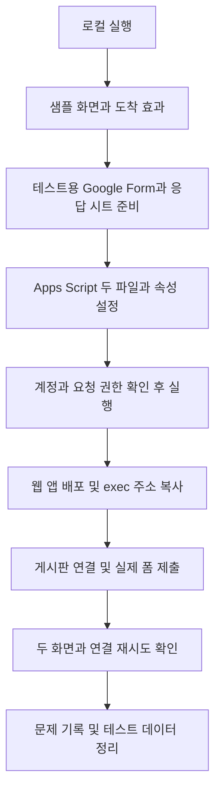

# 사용자 QA 가이드

본인의 Google 계정과 테스트용 응답 시트로 확인하는 순서입니다. 실제 권한 승인·배포·폼 제출은 사용자가 직접 진행합니다. 아래 체크박스는 실행 후 직접 표시하세요. 체크되어 있지 않은 항목은 검증 완료를 뜻하지 않습니다.

[README로 돌아가기](https://github.com/yeseul-garden/playful-booth-idea#readme) · [로컬 게시판](http://localhost:4173/) · [화면별 연결 튜토리얼](http://localhost:4173/setup.html)

## 확인 순서



## 준비

- [ ] Node.js 20 이상에서 `npm ci`, `npm run build`, `npm run dev`를 실행했습니다.
- [ ] [로컬 게시판](http://localhost:4173/)이 열립니다.
- [ ] 본인이 관리하며 테스트 데이터를 넣을 수 있는 Google Form·응답 시트를 준비했습니다.
- [ ] 새 Apps Script 프로젝트를 만들 수 있고, 해당 계정으로 시트를 열 수 있습니다.

실제 참여자의 개인 정보나 내부 의견 대신 알아보기 쉬운 가상 답변으로 먼저 확인하세요. 시트를 다른 사람이 볼 수 있도록 공개 공유할 필요는 없습니다.

## 샘플 화면 확인

1. **보드 만들기**를 누르고 행사명과 질문을 입력합니다.
2. 카드형과 원하는 손을 선택하고 **샘플로 미리보기**를 누릅니다.
3. 화면에 보이는 **샘플 응답 도착시키기**를 누릅니다.
4. 효과가 끝나면 다시 눌러보고, 설정으로 돌아가 손을 바꿔 반복합니다.
5. 상단에서 우주형으로 바꾸고 같은 버튼을 누릅니다.

- [ ] 행사명과 질문이 입력한 대로 보입니다. 질문을 비우면 질문 영역이 숨겨집니다.
- [ ] 카드형에서는 선택한 사람·고양이·강아지 손이 카드를 붙이고 사라집니다.
- [ ] 우주형에서는 말풍선 도착 효과가 나오며 손은 나오지 않습니다.
- [ ] 처음부터 표시된 샘플에는 도착 효과가 없고, 버튼으로 추가한 새 응답에 실행됩니다.
- [ ] 효과가 끝나면 버튼을 다시 사용할 수 있습니다.
- [ ] 두 화면을 전환해도 응답이 유지됩니다.
- [ ] 긴 답변을 클릭하면 전체 내용을 읽고 Esc로 닫을 수 있습니다.
- [ ] 좁은 창·모바일 크기에서 안내, 카드, 작성자, 버튼이 겹치지 않습니다.

기기의 동작 줄이기 설정이 켜져 있으면 손 애니메이션은 생략됩니다. 손 움직임 검사는 해당 설정을 끈 상태에서 진행하고, 마지막에 다시 켜서 움직임이 줄어드는지도 확인하세요.

## 실제 Google Form·Sheet·Apps Script 연동

### 1. 응답 시트의 열 확인

Google Form의 **응답** 탭에서 Sheets 아이콘을 눌러 응답 시트를 열거나 연결합니다. 첫 행은 열 제목, 둘째 행부터 응답이어야 합니다.

| 확인할 정보 | 본인 시트의 열 문자 |
| --- | --- |
| 제출 시각 | 직접 기록: ___ |
| 보드에 보여줄 답변 | 직접 기록: ___ |
| 작성자 이름 또는 식별값 | 직접 기록: ___ |

예를 들어 A/E/F라면 `TIMESTAMP_COLUMN=A`, `MESSAGE_COLUMN=E`, `AUTHOR_COLUMN=F`입니다. 기본 예시 A/B/C를 그대로 쓰지 말고 실제 열을 확인하세요. 열 제목이나 질문 문장이 아니라 맨 위의 알파벳을 사용합니다.

- [ ] 세 열이 서로 다르고 실제 응답이 들어 있는 위치와 일치합니다.
- [ ] 시트 파일 ID와 아래쪽 응답 탭 이름을 확인했습니다.

### 2. Apps Script 코드 넣기

1. [새 Apps Script 프로젝트](https://script.google.com/home/start)를 엽니다.
2. 기본 `Code.gs` 내용을 [저장소의 Code.gs](../integrations/google-apps-script/Code.gs) 전체로 교체합니다.
3. 파일 옆 **＋ → HTML**로 이름이 `Bridge`인 파일을 만듭니다.
4. [Bridge.html](../integrations/google-apps-script/Bridge.html) 전체를 붙여넣고 두 파일을 저장합니다.

- [ ] HTML 파일 이름이 `Bridge.html`입니다. `제목 없음.html`로 남아 있지 않습니다.
- [ ] ‘저장되지 않은 변경사항’ 표시가 사라졌습니다.

### 3. 스크립트 속성 저장

왼쪽 톱니바퀴 **프로젝트 설정 → 스크립트 속성**에 다음 여섯 항목을 추가하고 저장합니다.

| 속성 | 본인 환경에 입력할 값 |
| --- | --- |
| `SHEET_ID` | 시트 URL `/d/` 뒤부터 다음 `/` 앞까지 |
| `TAB_NAME` | 시트 아래쪽 응답 탭 이름, 띄어쓰기 포함 |
| `TIMESTAMP_COLUMN` | 1단계에서 확인한 제출 시각 열 |
| `MESSAGE_COLUMN` | 1단계에서 확인한 답변 열 |
| `AUTHOR_COLUMN` | 1단계에서 확인한 작성자 열 |
| `ALLOWED_ORIGINS` | 로컬 테스트는 `http://localhost:4173` |

로컬 출처는 코드에 기본 허용되어 있습니다. 다른 포트나 배포 주소라면 실제 출처를 추가하세요. 여러 출처는 쉼표로 구분합니다. 예를 들어 `https://your-name.github.io/event-board/`의 출처는 `https://your-name.github.io`입니다. 시트 URL과 Apps Script URL을 넣는 칸이 아닙니다.

- [ ] 속성 이름의 대문자와 밑줄을 정확히 입력했습니다.
- [ ] 속성을 저장했습니다. 실제 ID·계정·URL을 이 문서나 공개 이슈에 적지 않았습니다.

### 4. 읽기 실행과 권한 확인

1. 편집기로 돌아가 함수 목록에서 **`readBoothIdeas`**를 선택하고 **실행**을 누릅니다. `doGet`을 직접 실행하지 않습니다.
2. 승인 창이 뜨면 **권한 검토**에서 본인 계정과 프로젝트를 확인합니다.
3. ‘Google에서 확인하지 않은 앱’ 안내가 뜨면 개발자가 본인인지 확인하고 **고급**에서 추가 안내를 읽습니다. 본인이 만든 코드와 요청 범위를 이해하고 동의하는 경우에만 프로젝트 이동 링크와 **계속**으로 진행합니다.
4. 실행 로그에 **실행이 완료됨**이 나오는지 확인합니다. 오류가 있으면 해결한 뒤 다음 단계로 갑니다.

스크린샷 예시에는 ‘모든 Google Sheets 스프레드시트 확인, 수정, 생성, 삭제’ 권한이 표시됩니다. 이 연결 코드는 읽기만 하지만 승인 범위는 더 넓을 수 있습니다. 모르는 개발자의 앱이나 조직 정책상 차단된 앱을 그대로 진행하지 마세요.

- [ ] 실행 계정과 개발자가 본인인지 확인했습니다.
- [ ] 요청 권한을 확인한 뒤 동의 여부를 결정했습니다.
- [ ] 실행이 오류 없이 완료되었습니다. 빈 시트라면 결과가 비어 있어도 정상입니다.

### 5. 웹 앱 배포

1. 오른쪽 위 **배포 → 새 배포**를 누릅니다.
2. 톱니바퀴 유형 선택에서 **웹 앱**을 선택합니다.
3. 실행 주체 **나**, 액세스 **모든 사용자**를 확인한 뒤 배포합니다.
4. 배포 완료 화면에서 **웹 앱 → URL**의 복사를 누릅니다. 위쪽 **배포 ID**와 구분하세요.
5. 주소 끝이 **`/exec`**인지 확인합니다. 편집기 주소나 `/dev` 주소를 사용하지 않습니다.

이 설정은 방문자가 시트 접근 권한 없이도 선택한 답변과 작성자 값을 조회할 수 있게 합니다. `ALLOWED_ORIGINS`는 사용자 인증이 아닙니다. 회사 계정에서 ‘모든 사용자’를 선택할 수 없다면 관리자에게 확인하세요.

- [ ] 배포 ID가 아닌 웹 앱 URL을 복사했습니다.
- [ ] URL 끝이 `/exec`입니다.

### 6. 게시판 연결과 실제 제출

1. [게시판](http://localhost:4173/)의 **설정으로 돌아가기**에서 Apps Script 웹 앱 주소를 입력합니다.
2. **게시판 열기**를 누릅니다. 이번에는 샘플로 미리보기를 누르지 않습니다.
3. 기존 답변이 있다면 본문·작성자가 시트와 일치하는지 확인합니다. 기존 응답에는 새 도착 효과가 실행되지 않습니다.
4. 본인 Google Form에 `QA-01 새 응답 도착 확인`처럼 구분하기 쉬운 답변을 제출합니다.
5. 먼저 시트에 행이 추가됐는지 확인하고 게시판이 갱신될 때까지 기다립니다. 기본 확인 간격은 7초, 서버 캐시는 5초이며 요청 시간도 더해집니다. 시트 반영 후 20~30초가 지나도 보이지 않으면 아래 문제 해결 순서를 확인하세요.
6. 우주형·카드형에서 각각 새 답변을 제출해 도착 효과를 확인합니다.

- [ ] 샘플 안내와 샘플 데이터 대신 본인 시트의 응답이 표시됩니다.
- [ ] 새 제출의 본문과 작성자가 정확합니다.
- [ ] 새 응답이 한 번만 도착하고, 다음 갱신에서 같은 응답이 다시 등장하지 않습니다.
- [ ] 카드형에서는 선택한 손, 우주형에서는 말풍선 효과가 나옵니다.
- [ ] 화면을 전환해도 실제 응답과 연결이 유지됩니다.

## 데이터와 운영 확인

테스트 시트에서 가능한 항목만 진행하세요. 필수 질문을 바꾸거나 원본 데이터를 삭제할 필요는 없습니다.

| 테스트 | 예상 결과 |
| --- | --- |
| 같은 작성자로 두 답변 제출 | 카드 2개, 고유 작성자 수는 중복 증가하지 않음 |
| 작성자 빈 응답 추가 | 익명 표시, 익명 응답마다 참여자 수 1 증가 |
| 답변 본문이 빈 행 | 게시판에서 제외 |
| 긴 답변 | 카드에서 일부 생략 가능, 클릭하면 전체 표시 |
| 사용하지 않는 중간 열에 가상 값 입력 | 해당 값이 게시판 본문·작성자로 나타나지 않음 |
| 일시정지 중 실제 새 답변 제출 | 자동 페이지·모션은 정지, 데이터 수집은 계속; 재개 후 도착 처리 |
| 잠시 네트워크를 끊고 복구 | 마지막 정상 응답을 유지하고 복구 후 갱신 |
| 질문만 비우기 | 행사명은 유지, 질문 영역만 숨김 |
| 다른 브라우저에서 열기 | 행사와 연결 설정을 다시 입력해야 함 |

- [ ] 필요한 데이터·운영 항목을 확인했습니다.

## 튜토리얼 화면 QA

[연결 튜토리얼](http://localhost:4173/setup.html)을 엽니다.

- [ ] 텍스트만 읽어도 열 설정부터 웹 앱 URL 복사까지 진행할 수 있습니다.
- [ ] 화면 예시 11개가 처음에는 삼각형 토글로 접혀 있습니다.
- [ ] 토글을 열면 해당 단계의 이미지와 캡션이 보입니다.
- [ ] 이미지를 클릭하면 확대 창이 열리고 원본 크기 보기에서 스크롤할 수 있습니다.
- [ ] 닫기 버튼과 Esc가 동작합니다.
- [ ] 확대해도 계정 이미지·이메일·시트 ID·탭 이름·배포 ID·URL 등 가린 정보가 읽히지 않습니다.

## 잘 안 될 때

| 증상 | 확인 순서 |
| --- | --- |
| `SETUP_REQUIRED` | SHEET_ID와 TAB_NAME 저장 여부 |
| `TAB_NOT_FOUND` | 파일 제목이 아닌 아래쪽 탭 이름, 띄어쓰기 |
| `INVALID_COLUMN` | A/E/AA처럼 영문 열 문자만 입력했는지 |
| `DUPLICATE_COLUMN` | 세 항목이 서로 다른 열인지 |
| `ORIGIN_NOT_ALLOWED` 또는 연결 재시도 | 실제 게시판 출처와 ALLOWED_ORIGINS가 같은지 |
| 연결 주소를 넣었는데 샘플만 보임 | ‘샘플로 미리보기’ 대신 ‘게시판 열기’를 눌렀는지 |
| 실제 응답이 없음 | 시트에 행이 생겼는지 → 답변 열이 맞는지 → 웹 앱 URL·권한 확인 |
| 변경한 코드가 반영되지 않음 | 저장 후 배포 관리에서 새 버전으로 업데이트했는지 |
| 샘플 손이 안 보임 | 카드형인지 → 샘플 도착 버튼을 눌렀는지 → 일시정지·동작 줄이기 확인 |

## 결과 기록과 정리

문제가 있으면 아래 내용을 채워 전달해주세요. 실제 ID·배포 URL·이메일·응답은 지우거나 가린 뒤 공유합니다.

```text
확인 일시:
브라우저 / 화면 크기:
단계와 누른 버튼:
기대한 결과:
실제 결과:
오류 문구:
재현 순서:
```

- [ ] 사용자가 직접 실제 폼 제출부터 게시판 도착까지 확인했습니다.
- [ ] 테스트 전용 답변을 필요한 범위에서 정리했습니다.
- [ ] 더 사용하지 않는 테스트 배포·앱 권한은 본인 Google 계정에서 정리했습니다.

이 문서는 테스트 절차입니다. 실제 Google 연동 완료 여부는 실행한 사용자의 결과로 판단합니다.
